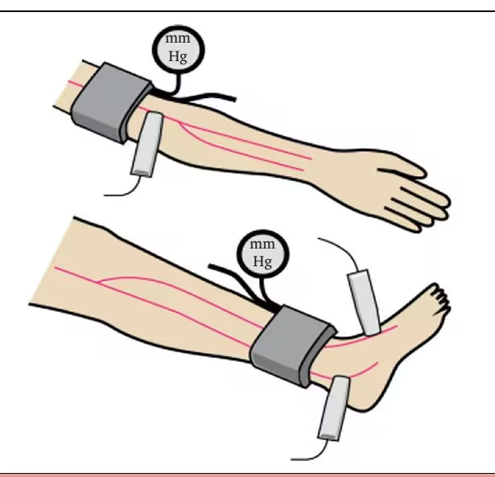
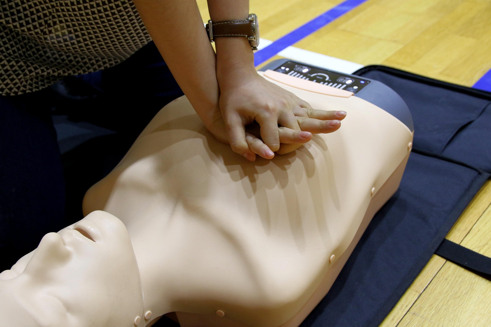
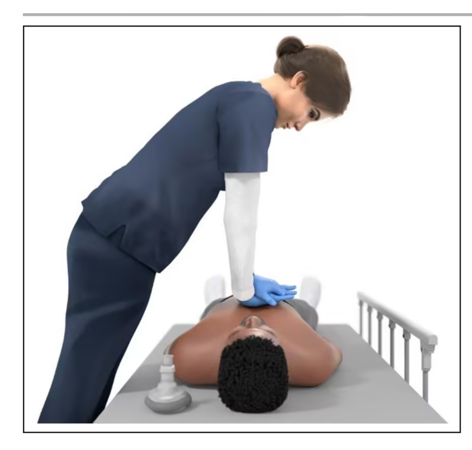

# 疑似心梗与心脏骤停：普通人的现场应对操作手册 v1.3

**简体中文** ｜ [English](README.en.md) ｜ Español · Français · Deutsch（待翻译）

> **版本 v1.3** ｜ 2026-10-22 ｜ 本文为**持续维护**的文档：随着医学、循证指南与研究的进展，我们会持续修订更新。
>
> 本文原文首发于微信公众号「自救者公社」，作者：顾眄，2026年10月22日。
>
> 本文是 Markdown 开源文档，可直接在线阅读、下载与转载：[查看](README.md) ｜ [下载原文 .md](https://raw.githubusercontent.com/shangshuo/cardiac-emergency-field-manual/main/README.md)

---

## 继承自原系列，别称 -《突发心血管急症应对指南 v1.3：从危险信号识别、紧急呼救，到现场施救与事前准备》

### 这是最初针对突发心脏病问题应急手册的v1.3版，相对于以前的版本，主要是调整了内容结构、更新了部分循证指南或研究的最新成果，最重要的是通过结构的调整，使内容的核心更具操作性，目的是希望任何一个普通人，在遇到类似问题时，也能根据SOP快速应对。

### 本系列内容的初衷，是发现虽然社会上整体在该领域进行了各类宣传，但更多还是在如CPR心肺复苏如何做、AED是什么等等工具化的具体操作，可在真实场景下，实际情况会更为复杂，有着更多决定最终结果的细节没有人提到，而且绝大部分人在应急场景下容易手足无措，所以一份更贴近现实的操作手册，或许可以帮助到更多人。

> **免责声明**
>
> 1. 本文主要来自于本人经验与思考，旨在为存在相似问题的他人提供有益的信息、建议及心理支持；
> 2. 文章中的信息和建议仅供参考，不构成医学建议，也也不应被视为替代专业医疗意见；
> 3. 任何人在参考或应用本文内容时，应自行判断并承担可能的风险；
> 4. 本文作者不对本文内容的准确性、完整性、适用性或有效性承担任何责任；
> 5. 任何因使用或依赖本文内容而导致的损失、伤害或不利后果，均由读者自行承担，与本文作者无关；
> 6. 如果您有任何疑问或需要医疗帮助，请立即前往正规医院或联系您的家助，不要因阅读本文而忽略或延迟寻求专业的医疗帮庭医生寻求专业治疗。

> **版权声明**
>
> 任何人或机构可根据自身或读者群需要直接转载或发布，且无需额外申请、标注出处或注明原作者，但不得更改文章内容；
>
> 如有任何争议或疑问，请参考前述免责声明。

### 目录参考

1. 行动手册
    - 独自一人时怎么办？
    - 现场两人时怎么办？
    - 现场多人时怎么办？
2. 解释说明
3. 建议居家常备物品

### 行动手册

> 注意：本文假设的场景，是正在发生急性心肌梗塞/心脏骤停的情况，因此上需要个体在问题发生时做出判断。

---

#### 独自一人时怎么办？

1. 致电**120**

    - 如果是普通时段，最好给熟悉自己情况、**距离自己最近**（比如邻居、社区工作人员）的人打电话，让他们帮忙协助致电120并用最快速度赶来提供支持；
    - 如果是在深夜，或附近无可能帮助人员，更佳方法是**致电110**，请求**110**协助联系120，并由所在地派出所出警快速前往所在地提供支持。致电110时，按照如下事项说明：

      （1）首先说明自己可能突发心梗，独自一人，随时失去意识，请110协助联系120；

      （2）其次告知自己的详细地址；

2. **开门**

    可以与打电话同步操作，在接电话时，同步将自己家中的门都预先打开，给120留好门方便直接进入。

3. 确保呼吸顺畅

    松开衣领、腰带，如有必要可直接脱下紧身的衣服；

4. **阿斯匹林**

    - 如果有**强烈撕裂样疼痛感**的，既**不要**服用**阿斯匹林**，也不要服用**硝酸甘油**；
    - 快速服用阿斯匹林**300mg**；
    - 国内日常最常见版本是**100mg/片**，美版通常是**86mg/片**，且常见为肠溶片，所以**国内版本**通常需要使用**3片**，**美版**需要使用**4片**，如果是**25mg/片**的版本至少一次要使用**12片**；
    - 必须**嚼服**，即：嚼碎直接咽下；

5. **侧卧**

    服用阿斯匹林后，在床或沙发上采用**右侧卧**的姿势（即左臂在上右臂在下，腿部被支撑抬起的姿势），等待救援人员的到来，如未服用阿斯匹林则保持背部靠后下身平躺的半卧姿势即可。

6. 吸氧

    如果感觉到**呼吸困难**，或持有指夹式血氧仪、智能手表/手环，可以测试血氧，测试结果**血氧小于等于90**，且家中配备有氧气瓶（如高海拔地区常见的1000ml便携式氧气瓶），可以采用深呼吸的方式吸氧，来缓解不适。

7. 测量血压

    如果意识清醒、确认支持人员即将到来，且症状无进一步加重，同时身边有血压仪，可在此阶段自测血压：

    

    - 测量血压时，从**右侧卧**姿势，换回半卧姿势（即上半身背靠床头或沙发背，腿部保持平抬在床或沙发腿部支撑上），注意双腿不要交叠；
    - 注意袖带的位置，应该与心脏高度保持一致；
    - 袖带底部与手肘保持3cm左右的距离（3cm大概是一个成年人食指与拇指并在一起的宽度）；
    - 需要测量**双臂**的血压值，即左臂、右臂均需要测量，先测量哪一侧均可；
    - 每侧需要**至少测量两次**，每次至少**间隔1分钟**；
    - 如果单臂连续两次测试的血压（主要是高压值）差值**大于10毫米/汞柱**，那么间隔至少1分钟后，再**测试第三次**，若还是存在**大于10毫米/汞柱**的差值，则间隔至少1分钟后，再测第四次、第五次……直至观察**近两次的值**相对稳定，即**小于10毫米/汞柱**；
    - **记录每次测量的时间、哪侧胳膊、血压值（高压/低压）**，如果身边有纸和笔，直接写下最佳；
    - 特别注意：

      （1）**双臂**存在**压差**，且**大于10毫米/汞柱**，若急救人员赶到，第一时间**告知医护人员**，若前面服用过阿斯匹林，也在第一时间同步告知急救人员；

      （2）血压值过低，如高压低于100毫米/汞柱；

      （3）血压值过高，如高压高于180毫米/汞柱；

8. 降温

    屋中有空调可以开至16度、18度的低温，身边有冰贴或冰袋，可以置于头部脑门儿上。

9. 心律失常

    - 如果佩戴有新型带有心电图功能的智能手表，注意观察是否有心律失常的提示，或自行主动测试，如有**房颤**、**室颤**或**房扑**提示，记录并在急救人员到达后第一时间告知；
    - 新型电子血压仪通常也会带有心律失常的监测，但是无法像心电检测可以辨别具体心律失常的类型，如果测量血压时发现有心律失常提示，同上，在急救人员到达时同步告知

10. 硝酸甘油

    如身边携带有硝酸甘油（气雾或舌下含片），如下条件**存在**时，则**不要**使用**硝酸甘油**：

    - 双臂血压的压差**大于10毫米/汞柱**
    - 血压（高压值）**低于120毫米/汞柱**，如有心脏病史且有服用相关药物，以平日同时段的血压值为基准，比如平时同时段血压值一般是100/70毫米/汞柱，则此时测量血压值至少不要低于平日值；
    - 高压值**小于等于90毫米/汞柱**
    - 48小时内使用过西地那非、他达拉非、伐地那非；
    - 胸背痛的主观感受，是**撕裂感觉**的；

    只有如上5条条件不符合，且同时**胸痛**为主要症状时，可按照说明进行口腔舌下喷雾，或舌下含服以缓解症状，否则不要使用；

    硝酸甘油的标准用量是：舌下含服**0.5mg**，**每5分钟**可重复1次，**最多3次**，即**15分钟**内总量**3次**，如依然无效，也不应再继续服用；

    常见原研版本硝酸甘油舌下含片是**0.6mg/片**版本，常见高销量的版本通常为**0.3mg/片**，在购买时务必记得并写清所购买的版本，在服用时要遵说明使用，避免服用过多（可能导致血压过低、心动过缓、晕厥）或服用不足的情况。

> 对于独自一人的状态，能做的事情不多，如上事项，最重要最核心的还是**联系急救人员**速速赶来，其他视具体情况，最后就是静卧，**不要再动**，安静等待急救支持人员的到来。

---

#### 现场两人时怎么办？

以下患者本人，我们称为“患者”，另外一人我们统称为“家人”。

1. 帮助患者第一时间在床上、沙发上**静卧**，除去后续步骤中必要的服药、测量血压等，患者均**不应再有任何动作**。

2. **呼叫120**

    - 如果家人自身健康，直接最快速度拨通**120**电话请求专业急救人员介入支持；
    - 如果家人自身行动能力受限或也时刻存在健康风险，拨通**110**请求所在地警务人员及社区人员的快速支持，同上，说清自己详细的居住地址和突发的心脏问题；
    - 如有熟悉情况且距离住处较近的朋友邻居，尽可能同步电话联系，能找2个人过来帮忙就能大幅提升救治效率，其中1人可直接前往住所附近路口等救护车最可能过来方向处等待，等车到后，以最快速度带过来，以避免因不熟悉路等情况而耽误急救时间。

3. **CPR心肺复苏**

    如果患者出现心脏骤停的情况，必须立即进行**CPR心肺复苏**。

    CPR心肺复苏核心三要素：**按压位置**，**按压频率**，**按压深度**，尽管标准流程方法拥有更科学、更合理的严谨性论证，但是对于不熟练、手忙脚乱的家人来说，只要这三点能做到位即可。

    - **如何判断**：患者失去意识，家人可以尝试拍打肩膀并大声询问，患者确认无响应，然后用最简单可靠判断脉搏的方式：直接**捏住脖子**，感应是否存在**脉搏**，如果感觉不到脉搏，**立即**实施**CPR心肺复苏**；
    - **患者躺平**，立即将患者从半卧位移至**平躺姿势**；
    - **清理呼吸道**，无论是假牙、口香糖还是什么东西都从嘴里直接掏出来，普通人没经验的，可以直接尝试用一只胳膊穿过患者的脖子下面当作一个支点，另一只手将患者下颌向上推，从侧面看嗓子到嘴是一条直线就可以；
    - **按压位置**，精确描述是**胸骨下半部**，虽然一般描述是乳头连线的下端，但实际多个指南及研究均发现这样定位并不可靠，所以换个思路，沿着两侧肋骨向上摸，摸到两侧肋骨的集中交汇点靠下（避开肋骨和剑突）便是正确**按压点**，如果衣服有大纽扣或其他配饰等妨碍按压，及时取下或直接退去妨碍的衣物；
    - **按压频率**，标准频率与方法是按压**100～120次/分钟+每30次切换人工呼吸2次**，也就是：按压30次，做人工呼吸2次，再按压30次，再人工呼吸2次……如此循环往复，实际需要结合患者的胸骨回弹（即按压下去后胸部回弹至原位），为方便计算，以**按压2次/秒**比较好记，也有很多人使用音乐（如《最炫民族风》来辅助判断节奏：苍[按]茫的[按]天[按]涯[按]是[按]我的[按]爱[按]，绵[按]绵的[按]青[按]山[按]脚下[按]花[按]正[按]开[按]……这里需要说明，《最炫民族风》的节奏要稍稍快于标准节奏，所以要结合回弹适当调整节奏）；
    - **按压深度**，标准深度**5cm**，大概相当于成年女性**食指+中指+无名指**三指并拢的高度，成年男性**食指+中指，再加无名指半指**的高度，按压这个深度需要足够的力气，且确实可能会造成肋骨或胸骨骨折（据统计至高可达78%），但生命第一，即便听到疑似骨折的声音，也要坚决继续实施按压，绝不能停；
    - **人工呼吸**，如上所述，按照标准应该每30次按压结合2次人工呼吸，即掰开患者的嘴，家人直接大口吸气后向患者口中吹气，如有介意且身边有纸巾、消毒湿巾等，可将此类纸巾/消毒湿巾垫于患者嘴上再吹气，这里的细节是，不要吸气吸进肺里再吐送出来，而是包住空气直接吹进患者嘴里，如果有前面提到过的1000ml便携式氧气瓶，直接按住向患者口中喷更佳，如果实在不熟练、不方便，可以直接**跳过人工呼吸**步骤，只要保持标准的胸部按压即可；

    

    - **按压手势**，请参考上图，对于成人的心肺复苏按压，一只手的手掌是主要发力点，按住胸骨下方的位置，另外一只手攥住下方的手，协助给予扶助的力，帮助达到足够的按压深度；此外，如果是儿童，成年人的单手掌可能面积过大，尤其是成年男性，所以根据儿童身体情况，可使用**单手三指（食指中指无名指）联合**实施按压；
    - **按压姿势**，正确的标准，是胳膊伸直，为了达到按压的深度和保持按压的频率，借助全身的力量向下压，2次按压/每秒，向下压深度5cm，这近乎是无氧运动，普通人如果是仅仅通过胳膊弯曲向下发力按压，坚持不了几分钟胳膊就会无力，所以记住核心要点是：**借助全身的力量向下压**，此外，此前需要通过电话招呼其他人来帮忙，其中一项重点即是普通人很难有持续的耐力完成持续按压，所以需要至少2个人，交替进行按压，以保持足够的心肺复苏效果；

      

    - **按压时间**，持续按，一直按，直到患者恢复心跳或急救人员到来；根据现场家人与前来支援人的实际情况，建议**每2分钟**换一个人进行按压；如果急救人员到来前，已经获取到了AED，则在完成2分钟的CPR心肺复苏后，进行使用AED进行分析，如果AED分析结论提示不适用除颤（电击），则立即放弃，继续保持按压，如AED分析可以进行除颤（电击），尝试后，患者依然没有恢复心跳，则取下AED电击片后，要**继续进行心肺复苏**的按压，不能停；即：

      （1）只有一个家人，则CPR心肺复苏不能停，按照**30秒按压+2次人工呼吸**的节奏持续进行，直到患者恢复心跳、急救人员到来或支持人员到来（或携带AED）；

      （2）一个家人，且到来第二个支持者，但未携带AED，按照**每人2分钟CPR心肺复苏**轮换交替，直到患者恢复心跳或急救人员到来；

      （3）一个家人，且到来第二个支持者同时携带AED，之后按照每**2分钟按压——>AED分析——>电击或不电击——>患者未恢复心跳——>继续2分钟按压——>AED分析……**的循环持续执行，直到患者恢复心跳或急救人员到来；

      （4）更多人来到现场支持，如上可多人轮换交替进行心肺复苏（及AED）的循环，直到患者恢复心跳或急救人员到来；

    > CPR心肺复苏是专业急救人员到来前，急性心肌梗塞发作/心脏骤停时，最有力的救助手段，最核心的三要素：**按压位置**、**按压频率**、**按压深度**务必牢记，想把人救回来，CPR的终点只有2个指标：**患者恢复心跳**，或**专业急救人员到来**。

4. **AED自动体外除颤仪**

    我们在呼叫120的部分表达过，一个人应付紧急情况是比较吃力的，最好同步再找至少2个人过来帮忙，其中1人熟悉位置可以去接120救护车，如果还能再叫来一个人，可以叫这个人在过来的路上，同步找AED自动体外除颤仪并且带过来，以防紧急需要。

    考虑到现场还有很多事需要处理，且万一出现心脏骤停的极端情况发生，必须立即进行CPR心肺复苏，所以若只有一个家人在旁，则绝对不可以出门去找AED。

    - **哪里寻找AED自动体外除颤仪**，使用手机上的地图应用（比如高德地图、Apple Maps等）直接搜索**AED**，一般大城市普及率已经非常高，临近医院、卫生所、学校、商场、街道/居委会或政府机构等通常都会配置，即便地图应用无法指导，到最近的这类场所问询能够找到的概率也非常大，但是在从自助机器上取出或从其他地方取出时，先确认一下**机器电量**，尽管应该是有专项维护，但我们不排除可能万一长时间没用且未来得及更换电池的情况，如果存在电量问题且现场无备用电池，立即去找下一个最近的，不要耽误时间，更不要耽误患者可能的使用；
    - **使用AED自动体外除颤仪**，同上CPR心肺复苏章节，如果患者发生了心脏骤停的情况，先进行CPR心肺复苏2分钟，再使用AED，大家不用担心不会使用，现在的AED均非常智能，电击贴片均有清晰图示展示，开机后全程语音引导（部分设备可能还有液晶屏幕的图像乃至视频引导教程），且是否可以进行除颤（电击）操作，机器可全部自己分析检查，用户只需简单按钮即可完成操作，唯一需要特别提醒注意的：**其他人务必离开患者至少1米以上**，绝对**不可以**与患者或患者身边可能的导电物品**接触**。
    - 如果使用AED进行除颤（电击）后，患者依然无响应，且AED提示需要再充电，该过程中因各厂家特点不一，这里只能统一建议关机并摘取下电极片，避免对救助人产生伤害，但该过程一定要快，而且取下电极片等待完成再充电前，必须快速介入再次进行CPR心肺复苏，间隔时间越短越好，能控制在**10秒之内**更好，但前提还是先保护好救助人自身，才能更好帮助患者。
    - AED与CPR可交替进行，直到急救人员到达后进入专业介入为止。

5. **阿斯匹林**

    同单人情况，首先确认是患者是否有**强烈撕裂样疼痛感**，如果是撕裂感的疼痛，则既**不要**服用**阿斯匹林**，也不要服用**硝酸甘油**；

    为患者找到阿斯匹林，视单片规格，一次**嚼服300mg**（国内100mg版本3片，美版86mg版本4片，25mg版本要嚼下12片）；

    如果家中没有，且在商业相对完善的区域，患者尚无高危风险呈现，此时使用外卖功能直接买，记得多给小费、写下“患者急发心梗帮忙快点儿送，万谢”或类似内容请求支援，争取第一时间送到；

6. **侧卧**

    服用阿斯匹林后，在床或沙发上采用**右侧卧**的姿势（即左臂在上右臂在下，腿部被支撑抬起的姿势），如未服用阿斯匹林则保持背部靠后下身平躺的半卧姿势即可。

7. 准备物品

    - 如果有**历史病例**、**服药清单**，提前找出准备好，待急救人员到呈给医护人员；
    - 纸和笔，假设患者未心脏骤停，急救人员尚未到来前有足够时间进行辅助健康状态监测，则直接记录数据供急救人员参考；
    - 硝酸甘油，视后面情况可能会需要服用，如家中无药同上，可外卖买药，没有足够的人手支持情况下，家人不许离开患者身边；
    - 1000ml便携式氧气瓶，如果有，快速找到，放到患者身旁，出现呼吸困难或血氧降低等情况，及时使用帮助缓解缺氧状态；
    - 血压仪，准备为患者进行血压测量，为急救人员提供宝贵参考数据；
    - 如家中还辅有血氧仪（指夹式或同等功能的智能手表/手环），支持心电图功能的智能手表或单导心电图机；
    - 冰袋或凉贴

8. 环境准备

    - 室内：除去北方严寒冬季之外，其他季节各区域均可打开窗户，增强通风换气，提升环境氧气含量，如果环境温度过高，及时开启空调，直接冷气开到最低；
    - 室外：特别注意如果是高温高湿环境，想办法降温、降湿度，包括白天可能遇到的遮阴，扇风；低温环境可以相对适应，除去特殊极寒，否则不用过多关注；

9. 健康监测

    - 血压监测：在单人章中已经有过详细介绍，这里简要概述

      （1）测双臂、双腿血压，共四肢的血压（因多家人照顾，可多测试下肢）；

      （2）测**上肢血压**时应为**半卧位**，血压计袖带位置与心脏平齐，袖带底部与肘部距离3cm左右，即大概一个成年人食指与中指并拢后的高度；

      （3）测**下肢血压**时应为**平躺位**，血压计袖带的佩戴位置在脚踝上方（距离脚踝2cm，即成年男性中指一指宽，女性大拇指宽度）；

      （4）先测上肢血压，完整测完一侧，再测量另外一侧，比如先测右臂，则待右侧胳膊至少测试2次或2次以上，获得完整稳定数据后，再切换至左胳膊；

      （5）每侧需要**至少测量两次**，每次至少**间隔1分钟**，连续2次测量的血压值（高压值）如果差值**大于10毫米/汞柱**，那么间隔至少1分钟后，再**测试第三次**，若还是存在**大于10毫米/汞柱**的差值，则间隔至少1分钟后，再测第四次、第五次……直至观察**近两次的值**相对稳定，即**小于10毫米/汞柱**；

      （6）完整测试完上肢血压后，将测试血压记录完整记录，如果两臂血压的压差**大于10毫米/汞柱**，特别标注，待医护人员到达后第一时间告知；

      （7）测试下肢血压，方法同上肢，此外下肢血压通常高于上肢血压，所以看到**下肢血压**值出现**高于上肢血压20乃至40毫米/汞柱**，也不用惊慌，冷静记录即可；

      （8）如果同遇到双下肢两侧血压值有差异，且差距**大于10毫米/汞柱**，同理，记录且标注，待急救人员抵达时同步告知；

      （9）在患者未发生危险的前提下，如有时间，可在完成如上测试后，计算一个值（ABI）：双上肢血压的测试结果中，取更高血压值的那一侧（最后两次高压血压值的差值小于10毫米/汞柱的稳定状态），先计算最近两次相对稳定高压值的平均值，再取同侧下肢的血压，同计算最近两次稳定高压值的平均值，最后计算**上肢血压** 除以 **下肢血压**：

      ABI = ((上肢sBP测试1 + 上肢sBP测试2)/2 ) / ((下肢sBP测试1 + 下肢sBP测试2)/2 )

      如果该值**小于等于0.90** 或 **大于等于1.4** 则特别记录并标注，待急救人员到来同步告知；

      （10）如超过30分钟，患者未出现极端事件，且急救人员尚未到来，可重复进行一次血压监测，如此循环监测，直至急救人员抵达为止；

    - 测量**血氧**，同单人章，如有指夹式血氧仪或智能手表/手环，可持续监测血氧，如连续**小于等于90**，有如便携式氧气瓶类工具的话，可以给予吸氧缓解；
    - 关注**心律失常**，如果有带心电图检测功能的智能手表，或便携式单导心电图机，可以给予每5分钟的循环监测：

      （1）如果出现如“室性早搏”，记录统计时间内的总数；

      （2）如果监测出现**房颤**、**室颤**、**房扑**这三项描述，特别记录，待急救人员抵达同步告知；

> 多了一个家人的情况下，急救人员依然是核心主力，家人最重要的点在于，依然需要**呼叫更多支援力量**，寻找更多支援工具，如果患者发生心脏骤停类极危事件第一时间介入，剩下的重点就是尽量给急救人员提供急救支撑数据与信息，尽量压缩所有医疗步骤之间的时间，提高积极结果的概率。

---

#### 现场多人时怎么办？？

##### 多人在场（大于等于2人），依然需要一个主导方，用以协调现场人力资源的支持，避免混乱，我们假定以主观视角介入，且作为主导方来操作。

1. 帮助固定患者，使患者平躺或半卧（有意识状态）于安全、开阔且平坦的场所，并维持秩序，如果人过多，一定让人群要散开，务必不能全部围在患者身边，除去核心能提供直接支持的人，其他人至少推开3米开外；

2. 同步第一时间，直接指定一名熟悉（至少是你认为可能熟悉）区域且具备清晰表达能力的人，**拨打120**，全权负责联系急救医护人员，如有必要（若现场除患者外，只有2人则最好不要离开现场）可赶往特定路口或区域，迎接急救人员车辆，快速第一时间赶往现场；

3. **CPR心肺复苏**

    若患者出现心脏骤停类极端情况，及时第一时间介入，并同步召唤其他掌握CPR心肺复苏的人员，如前所述，心肺复苏术近乎无氧运动，非常消耗体力，单人很难支撑，最好有至少2人可以轮换交替以缓解疲劳，但多人轮替CPR心肺复苏时，必须及时交替，**间隔不能超过10秒**。

    具体操作步骤方法这里不赘述，直接参考两人章节；

4. **AED自动体外除颤仪**

    只要有大于等于3人的情况，且均可正常行动，都可以由一个专人去附近寻找AED，比如前面分配拨打120的“联络专员”，可同步搜索附近的AED并去快速取回，具体AED搜索查找方法在两人章节中已有详细描述，此处不赘述。

    如果人力资源有足够冗余，在已经介入CPR心肺复苏后，依然可抬头指定某一个或某两个人，负责去寻找附近的AED，一定要指定到具体人，取回后是否使用以及基本方法，在两人章也有叙述，直接参考上面章节即可。

5. **老人孩子孕产妇等弱势群体**

    如果现场还有老人、孩子或孕产妇，且人力资源充沛，同步立即指定具体负责人，协助将老人、孩子**带离现场**，最好是具备一定同理心、同情心，有一定专业心理知识的更佳，一方面需要维持现场秩序，太多的人不仅会扰乱秩序、争夺有限空间内宝贵的氧气，还会对老人或孩子等弱势群体的心理产生冲击，只要有足够人，一定安排人将此类人群带离可视范围，对于孩子，可提供**肢体拥抱**来缓解心理冲击。

6. 药物或监测工具

    如果是在外，询问患者/查看患者是否有随身携带的药品，询问其他人是否携带了急救药品（阿斯匹林），具体使用方法直接查看两人章节；

    如果是在室内环境，同样问询患者/查看患者是否有随身携带的药品，同时也要问询环境中是否存在在两人章节总列举的各类健康监测工具，如果有，按照两人章节中叙述的方法使用。

7. **辅助留痕**

    即便不是全陌生人的环境，有富余人手，最好也能安排指定一个特定人员，进行全程视频记录，且记录范围更多集中在患者与施救人的范围，能够记录更多施救人的操作过程，用以安全留痕。现在是一个复杂的网络与现实混合社会，环境非常复杂，“害人之心不可有，防人之心不可无”，关键时刻，第三方的客观公正记录，可以避免很多麻烦的问题。

> 多人环境下，人力资源相对充沛，但整体上的操作方式和方法与两人场景下，没有明显差异，120专业急救人员依然是重中之重，但是更充沛的人力资源也可以在CPR心肺复苏中更多轮换，有人可以去寻找AED极大提升救回的概率，同时如果有老人孩子等弱势群体，也可以及时提供保护与心理支持，唯一需要注意的是，最好找专人在旁提供视频记录，在必要时可以额外提供避免麻烦的支持。

---

### 解释说明

> 特别1: 一定要记住，出现严重不适、疑似急性心肌梗塞发作或其他心脏疾病发作时，千万**不能自行驱车、打车，乃至骑车、步行等自行前往医院**，一定要叫120赶来，无论是骑车步行还是自行驱车等等，都可能增加心肌负担，在途中造成恶化的概率极高，如果是个人在家，能够接受的最大运动就是先去把门打开，防止120急救人员到来后因门锁着无法第一时间进入抢救，除此之外任何可能的走动都不应该发生，切记切记切记不要走动！

> 特别2：为什么要单独提出**撕裂感的疼痛**，这就是来自于我们最初提到的，心脏问题是一个复杂问题，并不是遭遇心脏骤停问题的患者都是心肌梗塞，如果有这种痛感，那么问题方向很大概率要定位到：**主动脉夹层/破裂**，此时严禁服用阿斯匹林或硝酸甘油，莫名服药只会让问题更糟，而120专业急救人员的专业处理+快速入院手术几乎是能活下来的唯一条路，所以痛感务必识别清楚，否则可能真的就没有机会了。

> 特别3: 为什么要测血压，以及为什么要测双臂乃至四肢血压？同上，因为双臂压差过大，也有极大概率指向**主动脉夹层/破裂**，同样的不能再使用阿斯匹林或硝酸甘油，同样的120处理+入院手术几乎是唯一可能存活的方式。

1. 心脏病（心肌梗塞、心脏骤停），随着现代医学的发展，心血管病已经拓展出为一个庞大的分支，本文主要针对的是最常见的心脏病（心血管病），也就是心肌梗塞——因为斑块脱落等导致主要心血管堵塞造成的严重问题，其他还有诸多详细分类或者针对整个心脏中不同子部分的问题不在本文的范围之内，但一些通用方法是值得借鉴的，比如无论什么情况，首先尽快寻求专业医疗资源的介入都是核心中的核心。

2. 拨打110协助这个方法，从标准规则规范和道义上并不是那么完全的值得宣扬，但是如果面对的是自己，是自己的亲人，本人认为在人命面前，即便有些道德瑕疵也是值得付出的代价——不知大家是否还记得在路上拦住救护车拿着手机摄像头逼迫医务人员主动交出AED，却唯独不愿自己违反规则规范，只会道德压力他人的事情，在至亲至爱面前，如有必要，付出一些代价也是值得的。

3. 人员支持，在突发疾病面前，自己是很难做什么的，即便有家人，如叙述重点的CPR心肺复苏，需要相当大的体力和体能支撑，单人很难维持长时间的心肺复苏，所以一定要想办法在最短时间内召集更多的人前来协助支持。

4. 年轻人更要注意，同是突发的急性心肌梗塞，年轻人往往比上了年纪的人更脆，因为老年人可能因为多年来累积的心血管堵塞，自身内血管可能会有代偿，也就是增加辅助的血管分支来辅助支持血流，而相对年轻的人还没有来得及长出代偿血管，一旦遇到一次高危风险事件，就再也不会有第二次机会了，所以相比老年人，具有高危风险（如高血压、高血糖、家族病史、肥胖、高BMI等）的年轻人、中年人，更应该注意。

5. 原子化社会，这其中，更高风险的，便是在大城市中独自生活的中青年人，过于原子化的社会已经很难像传统乡土社会快速召集一大群可以过来帮忙的人，尤其在公开场景，因为各种对立导致许多人已经不敢贸然出手相助，而独自在家，实际上确实也是除了本地派出所+网格员、外卖快递员外，除了赶在路上的120急救人员，能够确认在短时间内抵达所在家且有体制背书敢于施救的，可能除了拨打110，也实在找不到什么其他人能帮忙。

6. 关于阿斯匹林和硝酸甘油，实际上无论是硝酸甘油（喷雾或舌下含片）、阿斯匹林，都不是治疗急性心肌梗塞使用的，而且这两者也都没办法阻止心脏骤停，硝酸甘油（喷雾或舌下含片）是用来缓解心绞痛症状，而阿斯匹林防的是斑块破裂后血小板聚集形成的冠脉血栓与再梗死，同时大家应该知道的是，在医疗介入前的自主阿斯匹林或硝酸甘油，在临床结局中，尚未有明显的统计差异，这也是为什么**呼叫120**永远应该排在**首位**，专业医疗人员到达开展专业救治，才是明显提升存活率的不二法门。

7. 服用阿斯匹林后采用**右侧卧**姿势等待，目前也并没有充足的证明，只是有零星研究显示，右侧卧可能因为神经调控会有些许增加药物吸收效率的帮助，此处只是本人习惯的以“精益化管理”思维：即改善每一个哪怕细微的细节来争取整体上的更大概率，所以右侧卧并非严格方法，仅供参考，但静卧是严格适用的。

8. 吸氧，同上，如果并非血氧过低或呼吸困难，吸氧这个方式对于改善临床结局，也暂时缺乏证据。

9. 开窗通风+开空调低温+使用冰袋或冰贴敷于头上，开窗通风有部分原因与上一点吸氧类似，同是希望能够减少环境的二氧化碳含量，提高氧气含量，另外一点则还是与环境温度和患者体温控制有关，这点上医学界、指南和各项临床结局研究，也都还在争议之中，当然，这类争议不是说有害，而是临床死亡率是否降低的研究不一，有的研究证明降低体温可降低死亡率或减少愈后的后遗症，也有研究显示降低与否并没有明显变化，所以供大家批判性参考。

10. CPR心肺复苏核，主要方法及注意事项在行动指南章节中已经说明，这里需要额外补充的是，研究显示，CPR心肺复苏必须连续进行，如果交替人进行，或切换AED进行除颤，与CPR心肺复苏的交替时间间隔最好低于10秒，我们用不太专业严谨的比喻来描述，就像搅动一大盆水，需要持续不断用力搅动，水才会动起来，一旦等水域重新进入平静的状态，再想恢复刚刚运转起来的水流，就又要重新从中心点一点一点恢复，CPR心肺复苏的血液再灌注是同理，让人体内的血液被动再度传导起来，中间停止时间超过一定阈值（10秒），便又需要再次增加一个启动时间，间隔越长，效果越差。

11. 弱势群体的保护，这点要特别解释一下，无论是户外的公开环境，还是在家人聚集的私人场所，很多时候发生此类事情后，众人皆是手足无措，而弱势群体，尤其是儿童，处在这类环境中很容易受到巨大的心理冲击，而因繁乱的环境导致可能很多人都忽略了儿童的特殊保护，所以我在行动指南中特别强调，如果发现有儿童这类的弱势群体，只要不是实在没有人手，就一定一定一定要安排人来单独保护儿童保护弱势群体，务必首先带离当前的环境，孩子可以不懂社会问题，但是写在基因里的认识是一定能够理解这种恐惧的，这点务必要重视，千万不要忽略。

12. CPR心肺复苏培训，比较普及的专业培训包括美国⼼脏协会American Heart Association（AHA）的【Hearthsaver®拯救⼼脏课程】、红⼗字会的【红⼗字救护员证】，AHA的价格稍贵在RMB千元左右，有效期2年，红十字救援初级培训200元～300元，国际500～600元，三年有效期，当然线下学习、实操的效果更佳，但如果只想自己学习一下，相对系统的课程，也可以从国内MOOC课程平台中查找像《急救常识》、《现场⽣命急救知识与技能》、《复苏医学》等此类课程的系统学习。

---

### 建议居家常备物品

1. 阿斯匹林，常见，可靠，有效，价廉。发烧能用，发炎能用，风湿能用，本期主题的心脑血管能用，甚至碾碎了倒水里还能延长鲜切花的绽放时间，走出地球迈向深空，只能让我带一种药出去，我也必选阿斯匹林。

2. 紧急药盒，对于高危风险人群，建议购买一个紧急药盒，推荐那种类似雪茄盒的白色对开小药盒，设计合理，将常用急救药物放到不同位置，还有附带标签能写清药品过期时间，避免出危险时还要四处找。

3. 病历、服药清单，最好也能放置在一个固定的、好取用的地方，万一发生风险，急救人员到来，第一时间呈上——我在以往的科普文章里说过，绝大部分人遇到事情都是情绪驱动型，复杂环境下还能保持头脑冷静逻辑清晰表达……算了，日常非紧急情况语言表达清晰的人都很少见，所以直接递上病历、服药清单比不知所云的表达要强万倍。

4. 硝酸甘油，这个是如果需要医生会给开的，但是如我们前面所言，这不是治疗作用，也不是服用就能避免心肌梗塞，这点务必知晓。

5. 便携式氧气瓶（1000ml），在高海拔旅游区域经常能看到的产品，价格不贵，方便实用，我个人是建议大家可以买两瓶在家里放着的。

6. 血压计，这个不多说了，建议每家都应该准备一台，我个人还是倾向可以使用5号电池的版本，通用，快速可切换，至于是否需要内置心律失常检测，倒不是必须。

7. 智能手环/手表，视大家的使用习惯和预算，预算高且能接受更大体积、更频繁充电，基于健康方向选择有心电图功能的更佳，最基础的手环也可以，主要是用来辅助监测血氧。

8. 指夹式血氧仪，不愿意戴手表手环的，其实从专业性和风险阶段，确实还是指夹式血氧仪更适用，这里需要额外指出的是，血氧值高（大于等于95）不代表心脏没问题，但血氧低（小于等于90）那肯定有问题。指夹式血氧仪价格不高，几十元即可，个人还是建议在家里备一个，因为除去心脑血管类问题，现在高发的各种病毒支原体衣原体等呼吸道问题，遇到呼吸问题血氧仪也能提供支持，同时在这类问题下发现血氧问题，便携式氧气瓶也能提供有益的支撑。

9. 单导心电图机，这里再简单做个小科普，前面提到过的支持心电图功能的智能手表，还有市场上双手持即可简单测试的便携心电图设备，都是单导心电图机器，这类设备只能进行心律失常的检测，无法进行心肌缺血的判断，这点大家要知道。但是我们认为日常家用，准备这样一台设备即可，因为我们主要是想知道心肌梗塞是否进展到**房颤**等这类情况发生，如果发现到我们在前面介绍中提到过的几种心律失常类型，那么一定要严阵以待。最后，感谢中国制造，这种单导心电图设备，便宜的版本只需百元左右，有高危风险的家庭，我个人还是建议大家备一台。

10. 冰袋/冰贴，这个或许本来就很常用，无论日常发烧还是在等待急救人员到来前对大脑与身体降温的一种保护方法，备一些是值得的。

11. 笔和记事薄，虽然当前已经进入电子世界，但是像手机这类智能终端，因为安全性的提升，如果真遇到紧急情况，大家无法解开你的屏幕锁，手机里记录的信息再有价值，也等于0，越传统的工具，越可靠。

12. 5号电池，像我们上面说的血压仪、单导心电图仪等简单设备，更多还是采用5号电池驱动，我个人对于越来越多的锂离子电池化是颇有异议的，不仅随着时间推移电池效率下滑很难替换，而且万一紧急事件突发，尤其是多灾多难区域，内置锂电池没电了怎么办。

13. AED自动体外除颤仪，在大城市人群密集区域场所，现在的AED普及度已经很高，但是如果不住在这类场所，或者说经济相对富裕，自己在家配置一台，现在也是非常简单的。同样应该感谢中国制造，以往一台动辄2、3万RMB起步，甚至还可能是单相波产品，现在一台半自动产品大概只需不到3000元RMB，全自动、双向波360J级产品5000元档位即可买到，也可以让更多家庭拥有自备的可能，大大降低了门槛儿。唯一需要提出注意的，是AED也有维护成本，电极片和电池均需定期更换，其中电极片视有效时间（3～5年）价格可能在500～1000元/对，电池（一次性不可充电）1500元+，也即每5年的维护成本大概是首次购买机器总价的1/2左右，取舍由各位自行判断。

---

### 写在最后

以后题目就基本固定下来了：《疑似心梗与心脏骤停：普通人的现场应对操作手册 v1.3》，本系列内容是针对突发应急情况的操作手册性科普内容，另外针对日常一般性问题的操作手册（SOP流程），也是因为技术的发展，我在同步准备v1.1版。

与严肃医疗方向的内容相比，我只是补充了一些在实战中更具备可操作性，以及普通人在缺乏资源（如家人支持）情况下的“歪门邪道”方法，希望所有人都用不上，但是如果真的遇到，我也希望各位不要手足无措。

最后，预祝各位及所爱之人：
**身体无疾患 心灵无负担**

#### 更多⾏动，更多希望

> 1、越难的事情，才越有价值；
>
> 2、你的核⼼⽬标是什么？
>
> 3、Talk is cheap , Show me the solution；
>
> 4、种⼀棵树最好的时间是10年前，其次是现在；
>
> 5、解决问题，⽽不是发泄情绪，情绪毫⽆价值；
>
> 杀不死我们的，只会让我们更加强⼤
>
> *What doesn't kill you,only makes you stronger*

---

### 语言版本与文件 / Language versions & files

本文所有语言版本均以 **Markdown 源文件**形式存放在本仓库根目录，可直接在线阅读、下载、转载与分发（转载条款见 [LICENSE](LICENSE)）。配图统一存放于 [`images/`](images/)；作者手写原稿（未经编辑的原始稿）存于 [`raw/`](raw/)，供对照与溯源。

| 语言 | 文件 | 在线阅读 | 直接下载 | 状态 |
|---|---|---|---|---|
| 简体中文（原文） | [`README.md`](README.md) | [查看](README.md) | [下载 .md](https://raw.githubusercontent.com/shangshuo/cardiac-emergency-field-manual/main/README.md) | ✅ 已发布 v1.3 |
| English | [`README.en.md`](README.en.md) | [View](README.en.md) | [Download .md](https://raw.githubusercontent.com/shangshuo/cardiac-emergency-field-manual/main/README.en.md) | ✅ 已发布 v1.3 |
| 作者手写原稿（raw） | [`raw/疑似心梗与心脏骤停：普通人的现场应对操作手册 v1.3.md`](raw/疑似心梗与心脏骤停：普通人的现场应对操作手册%20v1.3.md) | [查看](https://github.com/shangshuo/cardiac-emergency-field-manual/blob/main/raw/%E7%96%91%E4%BC%BC%E5%BF%83%E6%A2%97%E4%B8%8E%E5%BF%83%E8%84%8F%E9%AA%A4%E5%81%9C%EF%BC%9A%E6%99%AE%E9%80%9A%E4%BA%BA%E7%9A%84%E7%8E%B0%E5%9C%BA%E5%BA%94%E5%AF%B9%E6%93%8D%E4%BD%9C%E6%89%8B%E5%86%8C%20v1.3.md) | [下载 .md](https://raw.githubusercontent.com/shangshuo/cardiac-emergency-field-manual/main/raw/%E7%96%91%E4%BC%BC%E5%BF%83%E6%A2%97%E4%B8%8E%E5%BF%83%E8%84%8F%E9%AA%A4%E5%81%9C%EF%BC%9A%E6%99%AE%E9%80%9A%E4%BA%BA%E7%9A%84%E7%8E%B0%E5%9C%BA%E5%BA%94%E5%AF%B9%E6%93%8D%E4%BD%9C%E6%89%8B%E5%86%8C%20v1.3.md) | ✅ v1.3 未编辑原始稿 |
| Español | `README.es.md` | — | — | ⏳ 待翻译 |
| Français | `README.fr.md` | — | — | ⏳ 待翻译 |
| Deutsch | `README.de.md` | — | — | ⏳ 待翻译 |

新增语言时，复制对应文件、按 `README.<语言代码>.md` 命名（如 `README.es.md`），并把顶部的语言导航换成链接即可。译文须保留原文的版本号与免责声明，译文中的补充说明必须明确标注为译者注。

**版本与更新**：当前为 **v1.3（2026-10-22）**。本文是持续维护的文档，随医学、循证指南与研究进展会不断修订；各语言版本在同一次更新中同步，版本号保持一致。
